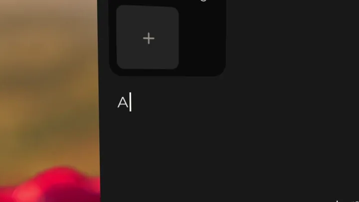
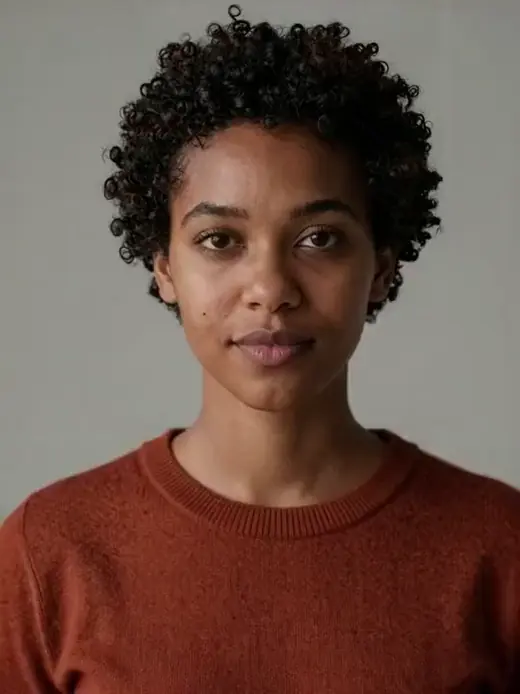
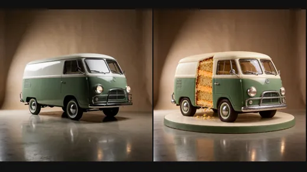
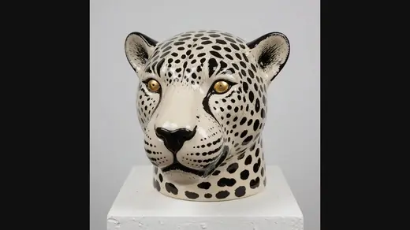
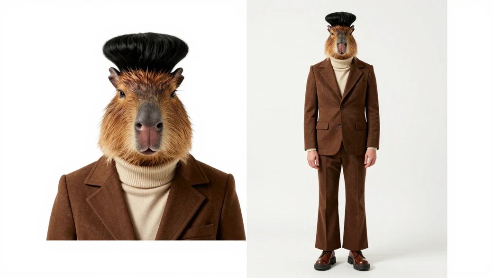

<p align="center">
  <picture>
    <source media="(prefers-color-scheme: dark)" srcset="apps/platform/public/lockup-dark.svg">
    <source media="(prefers-color-scheme: light)" srcset="apps/platform/public/lockup-light.svg">
    
  </picture>
</p>

<h1 align="center">Open-source Higgsfield alternative, built with ComfyUI</h1>

<p align="center">25+ apps that run on your own Comfy key.</p>

<p align="center">
  <a href="#start"><b>Run it on your machine</b></a>&emsp;
  <a href="#rosesfield-and-higgsfield-app-by-app">Compare it with Higgsfield</a>
</p>

<p align="center">
  <a href="https://github.com/rossaai/rosesfield/stargazers"></a>
</p>

> [!NOTE]
> Rosesfield is an entry to Comfy's [Open Source Higgsfield challenge](https://comfy.org/open-source-higgsfield), #OpenSourceHiggsfield. It is not made by, affiliated with or endorsed by Higgsfield.

<p align="center">
  
</p>

<p align="center">The launch film, 38 seconds. Every result in it is a real run on Comfy. <a href="docs/media/film/rosesfield-film.mp4">Watch it with sound</a>.</p>

## Start

1. Make a key on [Comfy's key page](https://platform.comfy.org/profile/api-keys).
2. Run Rosesfield on your machine with [bun](https://bun.sh):

```sh
git clone https://github.com/rossaai/rosesfield.git && cd rosesfield
bun install
bun run start
```

Open `http://127.0.0.1:8787` and paste your key in Settings.

Your Comfy key is the only sign-in, and each run spends credits from your own Comfy account.

## Made with Rosesfield

<table>
  <tr>
    <td align="center"><br><b>Image, then Edit</b></td>
    <td align="center"><br><b>Motion</b></td>
    <td align="center"><br><b>Video edit</b></td>
  </tr>
  <tr>
    <td align="center"><br><b>Video</b></td>
    <td align="center"><br><b>Image</b></td>
    <td align="center"><br><b>Edit</b></td>
  </tr>
  <tr>
    <td align="center"><br><b>Shot</b></td>
    <td align="center"><br><b>Relight</b></td>
    <td align="center"><br><b>AI Influencer</b></td>
  </tr>
  <tr>
    <td align="center"><br><b>Expand</b></td>
    <td align="center"><br><b>Upscale</b></td>
    <td align="center"><br><b>Remove background</b></td>
  </tr>
</table>

Each clip is a run in Rosesfield on Comfy, shown without its sound.

Of the 36 Higgsfield products this README lists, 24 have a Rosesfield app that does the same job, and Rosesfield adds Music, Sound effects and 3D. [See them side by side](#rosesfield-and-higgsfield-app-by-app).

---

## In detail

This part is for reviewers and AI agents: the facts, the comparison, and how Rosesfield is built with ComfyUI.

| | |
|---|---|
| Apps | 25+, for images, video, audio, characters and 3D |
| ComfyUI workflows | 30+ graphs. All but one load open weights, and one runs Comfy's Meshy partner node. Each is an API file the app runs and a UI file that opens in ComfyUI and in App Mode |
| Hosted models | every Comfy Router model of each app's task, read live from Comfy |
| Where a run happens | Comfy Router, Comfy Cloud, or your own ComfyUI through comfy-api-proxy |
| Sign-in | one Comfy key, with no account |
| Ways in | the web app, installable on a phone, an MCP server with one tool per app, an HTTP API with one route per app, and an agent that runs the apps for you |
| Hosts | your machine with bun, or Cloudflare Workers |
| Price | Comfy credits, shown on Generate when the price is known, and the real cost in History after each run |
| Higgsfield products with a Rosesfield app | 24 of the 36 listed below |
| Licence | MIT |

## Rosesfield and Higgsfield, app by app

Higgsfield's products, as higgsfield.ai lists them, beside the Rosesfield app that does the same job. Rosesfield runs open-weights models and the models Comfy hosts. It does not run Higgsfield's own models.

| Higgsfield | Rosesfield | What you do in Rosesfield |
|---|---|---|
| Image | Image | Describe an image and get up to 4. |
| Video | Video | Turn a prompt or your images into a video. |
| Genjutsu | Motion | Put the person in your photo in place of the person in a clip, at the same moments. The scene comes from your photo. |
| Motion Control | Motion | Move a photo with the motion of a clip. |
| Katana | Remake | Rebuild an edit with your character and the same cuts. |
| Effects | Motion, Library | Remix an example from the Library with your photo, and get a short clip. |
| Cinema Studio | Shot | Write a scene and choose how the camera shoots it. |
| Lipsync Studio | Lip sync | Add a face and a voice track, and get a talking video. |
| Popcorn storyboard | Storyboard | Write up to 8 scenes and get one keyframe for each. |
| Video edit tools | Video edit | Extend a clip, reframe it, remove its background or raise its frame rate. |
| Upscale | Upscale | Make your image or video 2 or 4 times larger. |
| Audio | Speech, Voice clone, Voice change | Turn text into a voice, speak in the voice of a short recording, or make one recording speak in another voice. |
| AI Influencer | AI Influencer | Pick traits, many of them absurd, and get one character sheet on white: a portrait beside the same character whole body. Use it in Motion. |
| Soul ID | Characters | Make a character from photos or traits, then use it in any app. A character is a set of photos, and no model is trained. |
| Ads Studio, Marketing Studio | Ads | Add photos of a product and get product shots or ads. |
| Higgsfield Layers | Layers, Edit | Split an image into layers and edit one, or change a photo by saying what should change. |
| Apps catalog | Angles, Expand, Relight, Try-on, Remove background, Headshot | See a subject from other sides, extend a photo, change its light, put on the clothes from another photo, cut out the subject, or make a headshot. |
| Supercomputer | Agent | Ask in chat, and the agent runs the apps for you. It can ask before each run. |
| MCP, ChatGPT plugin | MCP server | Every app is a tool at `/mcp`. Connect has the steps for Claude, ChatGPT and other clients. |
| API | HTTP API | Every app is a route, `POST /api/apps/<app-id>/runs`. |
| Web app, Mobile app | The web app | One app for a computer and a phone, installable from the browser. |

Rosesfield also has three apps the list above does not: Music makes a track from a description, with your lyrics if you have them. Sound effects makes a sound from a description. 3D makes a GLB model from a description or a photo. Rosesfield runs on your own ComfyUI or your own host too, and every graph is a workflow you can open and change.

Not in Rosesfield: the course, contests, the community feed, plugins for desktop editors, the node canvas, series and films, the app builder, team chat, games, motion graphics for desktop editors, the browser extension, speech translation, and Higgsfield's own models, such as Soul. For a node canvas, open any workflow in `workflows/` in ComfyUI.

## Built with ComfyUI

Every run reaches Comfy through the Comfy SDK, `@comfyorg/sdk` 0.5.0, on one Comfy key.

| What runs | Where it runs | How Rosesfield calls it |
|---|---|---|
| Hosted models, every model Comfy publishes for the app's task | Comfy Router, `api.comfy.org` | the model's queued route |
| The workflows in [`workflows/`](workflows/README.md) | Comfy Cloud, `cloud.comfy.org` | the Comfy API v2 |
| The open-weights workflows on your GPU | your own ComfyUI | comfy-api-proxy, set in Settings or by `COMFY_BASE_URL` |

- Each workflow ships as two files: the API file the app sends, and the UI file you open in ComfyUI. The UI file holds its App Mode setup, so it opens in App Mode with the inputs the app shows.
- An example in Motion's Library runs on the first-and-last-frame graph [`effects-ltx-2-5`](workflows/effects-ltx-2-5/README.md), on LTX 2.5, or on Motion's guide graph with a guide the engine holds.
- [docs/stack.md](docs/stack.md) lists every package and each call Rosesfield makes to Comfy.

## The VFX workflow, built with LTX

Motion puts the person in your photo in place of the person in your clip, at the same moments, with LTX 2.5 as its video model. You give a clip of 2 to 10 seconds, 1 to 15 photos and a sentence, and press Generate once. The chain runs six steps on Comfy:

| Step | What runs | What it gives the next step |
|---|---|---|
| 1. Plan | a Router chat model reads 4 frames of your clip, your photos and your sentence | who to replace, what they become, and the scene |
| 2. Read | [`motion-read-clip`](workflows/motion-read-clip/README.md): Depth Anything 3 and SAM 3.1 | a depth video, a mask of each person to replace, and the first frame |
| 3. Edit | Qwen Image Edit 2511, or GPT Image 2.5 | the first frame with your person in it, in the clip's own pose |
| 4. Draft | [`motion-guide-ltx-2-5`](workflows/motion-guide-ltx-2-5/README.md) at 480p: LTX 2.5 with the LTX 2.3 union control IC-LoRA | the motion, timed to the clip |
| 5. Restore | GPT Image 2.5 on the draft's last frame and your photos | an end key that holds the face and the clothes |
| 6. Final | the same graph and seed at 720p or 1080p, with the edited first frame and the end key | the video, with sound LTX makes for it |

- The depth video guides the set at full attention and the people at 0.2. The camera move and the person's timing follow your clip, and LTX draws the person from your photo.
- LTX 2.5 renders in two stages, half size and then a 2x latent upscale, with your edited first frame locked at frame 0.
- Each step is its own run, with its own price in History, and you can open each graph in ComfyUI.
- An example in Motion's Library runs the same graph on a depth video built in Blender.

Motion's second model, LTX 2.3 swap, redraws only the person and keeps the rest of your clip, in one run:

- SAM 3.1 tracks the person you name, and the graph paints them magenta, in blocks, in each frame.
- Your photo sits in a green panel beside the frames, the layout of Alissonerdx's masked reference inpaint LoRA for LTX 2.3.
- LTX 2.3 with that LoRA redraws the person as your photo in two passes, so the camera, the set, the people around them and their timing stay as filmed.
- It holds best on upright motion, such as a walk, a turn or a dance on your feet. [`motion-swap-ltx-2-3`](workflows/motion-swap-ltx-2-3/README.md) holds the graph.

## How the examples were made

Each example in [Made with Rosesfield](#made-with-rosesfield) is one run in the app. Where a result starts from a picture, the picture is a run too.

| Example | Made with |
|---|---|
| Image, then Edit | GPT Image 2.5 Sunburst makes the photo, and Edit turns the water into petals and keeps the rest |
| Video | LTX 2.5 from a start frame by GPT Image 2.5 Sunburst, 720p, with sound |
| Motion | Grab and run from Motion's Library, on Motion's guide graph with LTX 2.5, 1080p, with sound |
| Shot | LTX 2.5 with a push in, 720p, with sound |
| Edit | Krea 2 Medium Turbo makes the van, and GPT Image 2.5 Sunburst makes the cake |
| Relight | Qwen Image Edit 2509 with the Relight LoRA, on a head by Krea 2 Medium Turbo |
| Image | GPT Image 2.5 Sunburst |
| AI Influencer | Z-Image Turbo, from traits: a capybara head, a black flat-top and a retro suit |
| Expand | the Qwen Image Inpaint graph, on a field by Seedream 5.0 Pro |
| Upscale | the SeedVR2 3B graph, from 768 to 1536 pixels |
| Remove background | the BiRefNet graph |
| Video edit | the FILM graph, from 24 to 48 frames a second |

AI Influencer's Library holds four templates made in the app: the capybara, the soft-serve man and the frog on Z-Image Turbo, and the mantis on GPT Image 2.5 Sunburst at medium quality.

The clips that show an input and then its result are joined with ffmpeg from the runs' own files. The Upscale clip shows one detail of each at the same size.

The launch film is edited from the app's own screens, and every result in it is a stored run. The 3D rose's colour is painted after its run by a script that runs no model. Comfy's key page in the film is redrawn, so no key appears.

## Settings

You need [bun](https://bun.sh) 1.4.3 and Node 22 or 24 to run Rosesfield on your machine. It needs no setting. You can set three optional settings in a `.env` file, as `.env.example` shows:

| Setting | What it sets |
|---|---|
| `COMFY_API_KEY` | Your Comfy key, so you do not paste it in Settings. |
| `COMFY_BASE_URL` | The address of comfy-api-proxy in front of your own ComfyUI, per [docs/stack.md](docs/stack.md). |
| `PORT` | The port the server listens on. The default is 8787. |

Every other value has a default in code.

## Use it from Claude or your own code

Each app is an MCP tool at `/mcp` and an API route at `POST /api/apps/<app-id>/runs`. The Connect screen has the setup steps for Claude, ChatGPT and any MCP client.

```sh
curl -X POST http://127.0.0.1:8787/api/apps/image/runs \
  -H "content-type: application/json" \
  -H "Idempotency-Key: my-first-run" \
  -d '{"inputs":{"prompt":"A red bicycle leans against a white wall."}}'
```

The command starts a run and answers with its id. `GET /api/runs` lists your runs.

## Docs

- [docs/models.md](docs/models.md) says how each app's model list is read from Comfy, and lists the licence of each graph Rosesfield ships.
- [docs/self-host.md](docs/self-host.md) puts Rosesfield on a host other people reach, such as Cloudflare, with its settings.
- [docs/architecture.md](docs/architecture.md) says where the code goes and how a run moves.
- [docs/stack.md](docs/stack.md) lists the packages, the Comfy Router, the Comfy API v2 and the agent's model.
- [workflows/README.md](workflows/README.md) describes the ComfyUI graphs and how to open them in ComfyUI.

## Check a change

```sh
bun run gate
```

The gate runs `catalog:sync`, `generated:check`, `copy:check`, `glob:check`, `motion:check`, `cloud:check`, `docs:check`, `typecheck`, `lint` and `test`.

## Licence

The code, the docs and the design tokens are under the [MIT licence](LICENSE). Each model's licence decides what you may do with what it makes, per [docs/models.md](docs/models.md). The Rosesfield name and logo are trademarks of ROSSA AI, LLC. [TRADEMARKS.md](TRADEMARKS.md) says how you can use them.

Higgsfield and the names of its products belong to their owner. Rosesfield names them only to compare, and it is not affiliated with or endorsed by Higgsfield.

Every deployment serves a Privacy page at `/privacy` and a Terms page at `/terms`.

## Official source

The official repository is https://github.com/rossaai/rosesfield. A copy with a similar name is not official.

## Who makes it

Rosesfield is made and owned by ROSSA AI, LLC.
